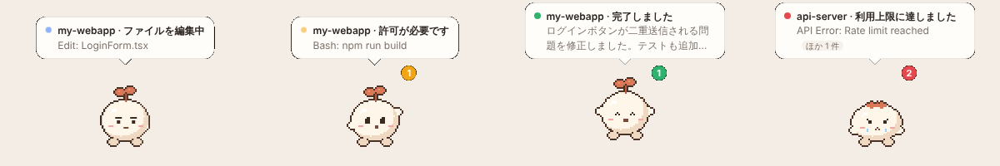
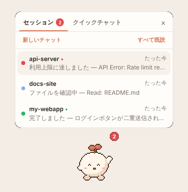
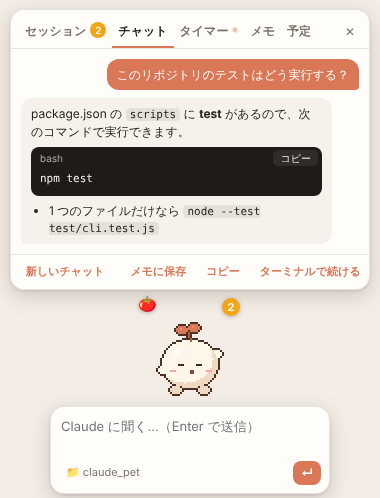
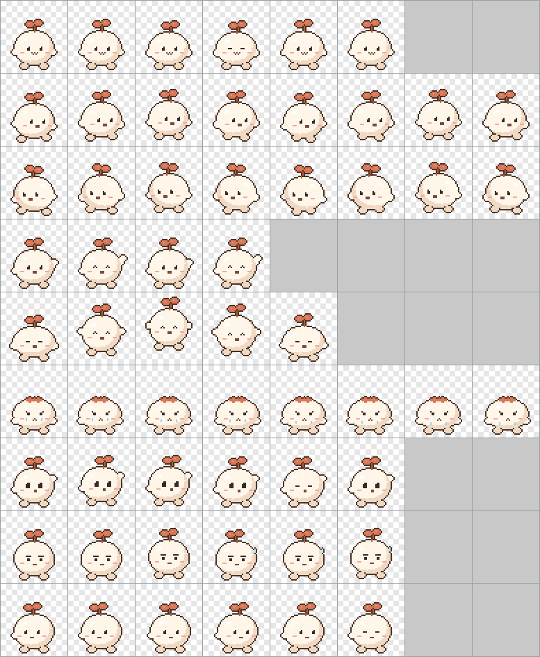

# Claude Pet

ChatGPT の「ペット」機能と同じことを **Claude Code** でできるようにする、デスクトップのペットです。

画面の端に小さなペットが浮かび、Claude Code が「作業中」「あなたの入力待ち」「完了」「エラーで停止」のどれなのかを動きと吹き出しで知らせます。ほかのウィンドウで作業していても、Claude の様子がひと目で分かります。



## ChatGPT のペット機能との対応

| ChatGPT / Codex のペット | Claude Pet |
| --- | --- |
| デスクトップに浮かぶアニメーション付きの相棒 | 同じ。常に手前に表示、ドラッグで移動、位置は保存 |
| 4 つの状態（実行中 / 入力が必要 / 準備完了 / ブロック中） | 作業中 / 入力待ち（許可・質問・プラン確認）/ 完了（未読）/ エラー |
| 複数のチャットの進み具合を追跡 | 複数の Claude Code セッションを一覧表示。いちばん急ぐものを吹き出しに表示 |
| ペットから新しいチャットを始める（Quick Chat） | クイックチャット。ペットの下の入力欄から Claude Code に質問し、続きはターミナルで再開できる |
| Mini 表示 | ミニ表示（状態と件数だけの小さなピル） |
| `/pet` で表示・非表示 | Claude Code で `/pet`（モデルを呼ばないのでトークンを消費しない） |
| カスタムペット / `hatch-pet` スキル | `/hatch-pet` で Claude がペットをコードで描いて作成。透過イラストをそのままペットにもできる |
| Codex のペット形式（`pet.json` + 8x9 スプライトシート） | そのまま読み込めます。`~/.codex/pets` や Petdex のペットも使えます |

## 必要なもの

- Node.js 22 以上
- Claude Code（ターミナル版で動作確認しています。`~/.claude/settings.json` のフックを読む環境なら同じように動きます）
- macOS / Windows / Linux（Linux は透過ウィンドウに対応したデスクトップ環境が必要です）

## インストール

```bash
git clone https://github.com/ORCA-IRUKA-222/claude_pet.git
cd claude_pet
npm install
npm link                # claude-pet コマンドを使えるようにする（任意）
claude-pet setup        # Claude Code にフックと /pet, /hatch-pet を登録
claude-pet              # ペットを起動
```

`npm link` をしない場合は `node bin/claude-pet.js setup` のように実行してください。

`setup` は `~/.claude/settings.json` に Claude Pet のフックを**追記**します（既存の設定やフックはそのまま残り、元のファイルは `settings.json.claude-pet.bak` にバックアップされます）。設定は次に起動した Claude Code のセッションから有効になります。

### 更新する

```bash
claude-pet update
```

`git pull` で最新版を取り込み、必要なら `npm ci` を実行して、ペットを新しいバージョンで起動し直します。`npm link` や `npm install` が書き換えた手元のファイルは `git stash` に退避するので、`git pull` が止まることはありません。

手動で `git pull` した場合も、`claude-pet` を実行すれば古いペットを新しいバージョンで起動し直します。

### うまく動かないとき

```bash
claude-pet doctor
```

ペット本体が最新か、`claude` コマンドの場所、フックの登録、このPCにある Claude Code の会話記録の数、自動起動の設定を表示します。

### クラウドの Claude Code（claude.ai/code・Claude アプリ）

クラウドで動く Claude Code はあなたの PC に直接つながらないので、クラウド側のフックが状態を**暗号化**して無料の通知中継サービス [ntfy.sh](https://ntfy.sh) に送り、ペットがそれを受け取ります。中継サーバーには暗号文しか見えません（AES-256-GCM。鍵はあなたの PC とクラウド環境の設定にだけあります）。

```bash
claude-pet cloud setup
```

表示される手順どおりに、claude.ai のクラウド環境の設定で

1. 「ネットワークアクセス」の許可ドメインに `ntfy.sh` を追加
2. 「セットアップスクリプト」に表示された 1 行を追加

すると、それ以降に始めたクラウドセッションがペットの一覧に ☁ 付きで出ます。「ブラウザで開く」でそのセッションを開けます。

```bash
claude-pet cloud          # 状態（接続中か）
claude-pet cloud test     # PC 側だけで、中継からペットに届くか確かめる
claude-pet cloud off      # やめる（on で再開）
```

セットアップスクリプトはこのリポジトリの今のブランチから `cloud/setup.sh` を読み込みます。ブランチを消したり変えたりしたら、`claude-pet cloud setup` で新しい 1 行を表示して貼り直してください（鍵は同じものが使われます）。

### claude.ai のチャット（ブラウザ）

Chrome / Edge で claude.ai を使うときは、拡張機能で「返答中」「返答完了」をペットに出せます。

1. `chrome://extensions`（Edge は `edge://extensions`）を開き、「デベロッパー モード」をオンにする
2. 「パッケージ化されていない拡張機能を読み込む」で、このリポジトリの `extension` フォルダを選ぶ

claude.ai のチャットが一覧に 🌐 付きで出ます。拡張機能はページを読むだけで、操作はしません。ペットへはイベントの報告だけができ、設定は変えられません。

### PC 起動時に自動で起動する

```bash
claude-pet autostart on     # やめるときは off、今の設定は autostart だけで表示
```

右クリックメニューの「PC 起動時に起動」でも切り替えられます。サインインしたときに Electron を直接起動するので、ターミナルの画面は開きません（Windows はレジストリの `HKCU\Software\Microsoft\Windows\CurrentVersion\Run`、macOS は `~/Library/LaunchAgents/dev.claude-pet.plist`、Linux は `~/.config/autostart/claude-pet.desktop` に登録します）。終了したあとは、Claude Code の中で `/pet` と打てばターミナルを増やさずに起動できます。

## 使い方

| 操作 | 動作 |
| --- | --- |
| ペットをクリック | セッション一覧を開く / 閉じる |
| ペットをドラッグ | 移動（走って付いてきます） |
| ペットを右クリック / トレイアイコン | メニュー（ペットの切り替え、サイズ、ミニ表示、通知など） |
| 吹き出しをクリック | セッション一覧を開く |
| `Ctrl+Alt+P`（macOS は `Cmd+Option+P`） | ペットの表示 / 非表示 |
| `Ctrl+Alt+C`（macOS は `Cmd+Option+C`） | クイックチャットを開く |
| `Esc` / ✕ | 入力欄・一覧を閉じる（一覧を閉じると空の入力欄も一緒に閉じます） |

### 状態の見方

| 状態 | ペット | いつ |
| --- | --- | --- |
| 作業中 | 集中して作業 / ファイルを読むときはきょろきょろ | プロンプトを送ってから応答が終わるまで |
| 入力待ち | 手を挙げて呼ぶ（オレンジ） | ツールの許可、`AskUserQuestion` の質問、プランの承認などを待っているとき |
| 完了 | ジャンプして喜ぶ → 緑のバッジ | 応答が終わって、まだ見ていないとき |
| エラー | しょんぼり（赤いバッジ） | 利用上限・認証エラーなどで止まったとき |
| ひと休み | 呼吸・まばたき | 何も起きていないとき |

バッジの数字は「入力待ち + エラー + 未読の完了」の件数です。一覧で項目を開くか「既読」を押すと消えます。次のプロンプトを送ったときも自動で消えます。

### セッション一覧



項目を開くと、最後のプロンプトと Claude の返答が読めます。「ここで続ける」でクイックチャットに会話を読み込んで続きを話せます。「Claude アプリで開く」は Claude デスクトップアプリで、「ターミナルで開く」は `claude --resume <セッション>` を新しいターミナルで開きます。

ペットを起動する前の会話も、Claude Code の会話記録（`~/.claude/projects/`）から直近 7 日分・最大 20 件を読み込んで一覧に出します（10 分ごとに読み直し）。クラウドの Claude Code とブラウザの claude.ai は、下の「クラウドの Claude Code」「claude.ai のチャット（ブラウザ）」の設定をすると一覧に出ます。

### クイックチャット



ペットから直接 Claude に頼めます。入力欄の送り先で、どこで動かすかを選びます。

| 送り先 | 動き |
| --- | --- |
| PC で | この PC の Claude Code（`claude -p`）。返事はペットに出ます。📁 のフォルダで作業します |
| クラウドで | クラウドの Claude Code。📁 のフォルダの GitHub リポジトリで作業し、Claude アプリや claude.ai/code にも出ます。今の Claude Code では、ペットがターミナルを開いて `claude --cloud` で始めます（下の「制限」） |
| チャット | Claude アプリの普通のチャットを新しく開いて質問します（`claude://claude.ai/new?q=…`）。返事はアプリで見ます |

モデルとエフォートは、ふだんは **Opus 5.5・超高** です（入力欄に表示されます）。右クリックメニューの「モデルとエフォート」で、Fable 5.1 / Sonnet 5.5 や、エフォート（中・高・超高・最大）に変えられます。「PC で」「クラウドで」と、ペットから開くターミナルのすべてに使われます。

📁 を押すと、最近使ったフォルダ、「フォルダを選ぶ…」、「GitHub のリポジトリを使う…」が出ます。リポジトリを `owner/repo` か URL で入力すると、`~/claude-repos/<owner>/<repo>` に取得してそこで作業します（初回だけ。プライベートリポジトリは Git のログイン画面が出ます）。続けて送ると同じ会話の続きになります。

`claude` コマンドは PATH のほか、よくあるインストール先（Windows は `%USERPROFILE%\.local\bin` や `%APPDATA%\npm`）や、VS Code・Claude デスクトップアプリに同梱されたものからも探し、見つかった中で**いちばん新しい版**を使います（`claude-pet doctor` で一覧と版を確認できます）。Claude Code を一度使うと、フックが Claude Code の場所をペットに伝えるので、PC 起動時に自動で起動した場合でも見つかります。どうしても見つからないときは、設定の `claudePath` に場所を書いてください。

「新しいチャット」を押しても前のチャットは消えません。セッション一覧（💬 付き）で開いて「ここで続ける」を押すと、その続きから話せます。クイックチャット以外の Claude Code の会話も同じように続けられます。

「アプリ」（一覧では「Claude アプリで開く」）を押すと、その会話を Claude デスクトップアプリの Claude Code で開きます。`claude --desktop --resume <セッション>` と同じリンク（`claude://resume?session=…`）を直接開くので、コンソールは出ません。Claude デスクトップアプリ 1.1.9669 以降が必要です。右クリックメニューの「クイックチャットを Claude アプリにも表示」をオンにすると、新しいクイックチャットは最初の返事が来たときに自動で Claude アプリにも開きます。クイックチャットは PC の Claude Code で動くので、claude.ai や Claude アプリの普通のチャット履歴には入りません。

クイックチャットは軽い質問向けです。ファイル編集などの許可が必要な作業は自動では許可されないので、「ターミナル」でいつもの Claude Code に引き継いでください。

### ミニ表示


右クリックメニューの「ミニ表示」か `/pet mini` で、状態と件数だけの小さな表示になります。`/pet full` で元に戻ります。

### `/pet` コマンド

Claude Code の入力欄で使えます。フックが処理するので、モデルは呼ばれずトークンも使いません。

```text
/pet              表示 / 非表示（起動していなければ起動）
/pet show | hide
/pet mini | full
/pet list         使えるペットの一覧
/pet use <id>     ペットを切り替え
/pet next         次のペットに交代
/pet rotate on | off | <分>   一定時間ごとに自動で交代
/pet quit         終了
```

ターミナルからは `claude-pet toggle`, `claude-pet status`, `claude-pet use <id>` なども使えます（`claude-pet help` で一覧）。

### ペットを自動で交代する

1 体に決められないときは、一定時間ごとにペットを入れ替えられます。交代すると、新しいペットが手を振って吹き出しで名前を知らせます。

```bash
claude-pet rotate on --every 60            # 1 時間ごとに交代（すべてのペットから）
claude-pet rotate on --group "グループ名"   # pet.json の group が同じペットだけで交代
claude-pet next                            # 今すぐ交代
claude-pet rotate off                      # やめる
```

Claude Code からは `/pet rotate on`, `/pet rotate 30`（30 分ごと）, `/pet next` でも操作できます。右クリックメニューの「ペットの交代」でも、オン・オフ、間隔（15 分〜3 時間）、対象のグループを選べます。

- 全員が一度ずつ出てから次の一巡に入るので、同じペットばかり続くことはありません。
- メニューや `/pet use` で選んだペットは、そこから 1 回分の間隔だけ表示が続きます。
- スリープから復帰したときも、時間が過ぎていればすぐ交代します。

## ペットを増やす

### Claude に作ってもらう（`/hatch-pet`）

```text
/hatch-pet 青いペンギン。マフラーを巻いている
```

ChatGPT の hatch-pet は画像生成でペットを作りますが、Claude は画像を生成しないので、**ペットを JavaScript のコードでピクセルアートとして描きます**。Claude はデザインを書き、スプライトシートに書き出し、できた画像を自分で見て直してから、インストールまで行います。

自分で描く場合は [`tools/designs/mochi.js`](tools/designs/mochi.js)（標準ペットの Mochi）が見本です。

```bash
claude-pet build path/to/design.js --install
claude-pet use <id>
```

複数のキャラクターをまとめて作るときは、`{ template: 'chibi', group, characters: [...] }` を書いたファイルを `build` に渡すと、[`tools/designs/chibi.js`](tools/designs/chibi.js) のテンプレートで 1 体ずつ書き出し、`group` 付きでインストールします（交代のグループに使えます）。



### イラストからペットを作る

背景が透明な PNG / WebP / GIF のイラストは、そのままペットにできます。動き（呼吸・作業中の弾み・入力待ちの合図・完了のジャンプなど）はアプリが付け、輪郭には柔らかい影が付きます。

```bash
claude-pet add-image ~/Pictures/chara.png --id chara --name キャラ名 --height 320
claude-pet use chara
```

| オプション | 内容 |
| --- | --- |
| `--id` | ペットの id（英小文字・数字・ハイフン）。省略すると名前から作ります |
| `--name` | 表示名 |
| `--height` | 「大」サイズでの高さ（px）。「小」はその半分、「中」は 3/4 です。省略するとドット絵と同じ 208px |
| `--group` | グループ名。`claude-pet rotate on --group <名前>` で、同じグループのペットだけで交代できます |
| `--state <状態>=<画像>` | 状態ごとに別のイラストを使う（`idle`, `running`, `waiting`, `ready`, `failed`、クリックしたときの `waving`）。何度でも指定できます。`ready` の絵は、完了した結果を見るまで表示され続けます |

```bash
# 例: ふだんは笑顔、作業中は真剣な顔、完了したらガッツポーズ
claude-pet add-image smile.png --id chara --name キャラ名 --height 320 \
  --state running=serious.png --state ready=victory.png
```

背景を自動で消す機能はありません。背景付きの画像は、透過 PNG にしてから追加してください。

### Codex / ChatGPT / Petdex のペットを使う

Codex 形式のペット（`pet.json` + `spritesheet.webp|png`、192x208 のセルが 8 列 x 9 行）は変換なしで使えます。次のフォルダを自動で探します。

| 場所 | 内容 |
| --- | --- |
| `~/.claude-pet/pets/<id>/` | Claude Pet 用（`/hatch-pet` や `add-image` の出力先） |
| `~/.codex/pets/<id>/` | Codex / ChatGPT の hatch-pet で作ったペット |
| `~/.petdex/pets/<id>/` | `npx petdex install <name>` で入れたペット |

追加したら右クリックメニューの「ペットを再読み込み」か `/pet list` で確認できます。

## 設定

`~/.claude-pet/config.json` に保存されます。メニューで変えられないものは直接編集してください（再起動後に反映）。

| キー | 既定値 | 内容 |
| --- | --- | --- |
| `pet` | `"mochi"` | 表示するペット |
| `scale` | `0.5` | 大きさ（0.5 / 0.75 / 1） |
| `mini` | `false` | ミニ表示 |
| `showBubble` | `true` | 吹き出しを表示 |
| `notifications` | `false` | 入力待ち・完了・エラーでデスクトップ通知 |
| `language` | `"ja"` | `"ja"` または `"en"` |
| `shortcuts.toggle` / `shortcuts.quickChat` | `CommandOrControl+Alt+P` / `+C` | グローバルショートカット（空文字で無効） |
| `quickChat.permissionMode` | `"default"` | クイックチャットの権限モード（`plan`, `acceptEdits` など） |
| `quickChat.model` | `"claude-opus-5-5"` | クイックチャットで使うモデル |
| `quickChat.effort` | `"xhigh"` | エフォート（`low` / `medium` / `high` / `xhigh` / `max`） |
| `claudePath` | `null` | `claude` コマンドの場所（PATH にない場合） |
| `terminalCommand` | `null` | 「ターミナルで開く」のコマンド。例: `"wezterm start --cwd {cwd} -- {command}"` |
| `rotation.enabled` / `rotation.intervalMinutes` | `false` / `60` | ペットの自動交代と、その間隔（分） |
| `rotation.group` / `rotation.pets` | `null` / `[]` | 交代するペットをグループ名か id の一覧で絞る（両方空ならすべて） |
| `rotation.order` | `"shuffle"` | `"shuffle"`（一巡ずつランダム）または `"sequence"`（順番） |
| `staleMinutes` | `30` | 何も届かない「作業中」をひと休みに戻すまでの分数 |
| `port` | `47717` | ペットが待ち受けるポート（環境変数 `CLAUDE_PET_PORT` でも指定可） |

## 仕組み

```text
Claude Code ──(hooks)──▶ src/hook/pet-hook.js ──HTTP──▶ ペット (127.0.0.1:47717)
   SessionStart / UserPromptSubmit / PreToolUse / PermissionRequest /
   Notification / Stop / StopFailure / SessionEnd など
```

- フックは受け取ったイベントを小さく要約して、ローカルのペットに送るだけです。何も出力せず、ペットが起動していなくてもすぐ終了するので、Claude Code の動作には影響しません。
- ツールごとに発生するイベント（`PreToolUse` など）はバックグラウンド（`async`）で実行し、Claude を待たせません。
- `/pet` だけは `UserPromptExpansion` フックで先に処理し、展開をブロックします。そのためモデルは呼ばれません。
- 通信は `127.0.0.1` だけで、外部には何も送りません。ブラウザからのリクエストは拒否します。

## アンインストール

```bash
claude-pet uninstall    # フックと /pet, /hatch-pet、PC 起動時の自動起動を削除（ほかの設定は残ります）
```

そのあと `claude_pet` フォルダと `~/.claude-pet` を削除してください。

## 制限

- Claude アプリ（デスクトップ・スマホ）の普通のチャットは、ペットから送ることはできますが（送り先「チャット」）、返事や状態は追跡できません。外に状態を知らせる仕組みがないためです。ブラウザで claude.ai を使う場合は拡張機能で追跡できます。
- 送り先「クラウドで」：今の Claude Code（2.1.310 で確認）は、新しいクラウドセッションをターミナルからしか始められません（`claude -p --cloud` は使えない設定になっています）。そのためペットはターミナルを開いて `claude --cloud "<依頼>"` で始めます。ターミナルは閉じても作業はクラウドで続きます。初めてのフォルダでは、フォルダを信頼するか聞かれることがあります。
- クラウドの Claude Code は、中継（ntfy）経由なので数秒遅れることがあります。ツールの動きは数分おきにだけ届きます。
- `Esc` で中断した応答には `Stop` が届きません。その場合、次のプロンプトを送るか、Claude Code の `idle_prompt` 通知が届くまで「作業中」のままです（最長でも `staleMinutes` 後にひと休みに戻ります）。
- Linux の Wayland ではウィンドウの位置を変えられない場合があります。

## 開発

```bash
npm test             # テスト
npm start            # ペットを起動（electron .）
npm run build:pet    # tools/designs/mochi.js から pets/mochi とアイコンを作り直す
```

| 場所 | 内容 |
| --- | --- |
| `src/hook/pet-hook.js` | Claude Code から呼ばれるフック |
| `src/core/sessions.js` | フックのイベントからセッションの状態を決める |
| `src/core/history.js` | 起動前の会話を会話記録から読み込む |
| `src/core/autostart.js` | PC 起動時の自動起動の登録 |
| `src/hook/cloud-hook.js`, `cloud/setup.sh` | クラウドセッション用のフック（暗号化して ntfy に送る） |
| `src/core/relay.js` | ntfy から受け取ってペットに渡す |
| `extension/` | claude.ai 用のブラウザ拡張 |
| `src/core/server.js` | ローカルの受け口 |
| `src/core/quickchat.js` | クイックチャット（`claude -p --output-format stream-json`） |
| `src/core/installer.js` | `setup` / `uninstall` |
| `src/electron/` , `src/renderer/` | デスクトップアプリ |
| `tools/` | ピクセルアートの描画とスプライトシートの書き出し |
| `skills/` | `/pet` と `/hatch-pet` のひな形 |
